# Useful-apps-for-Windows
В данном репозитории мы подробно рассмотрим ряд полезных бесплатных приложений для Windows, способных значительно упростить вашу работу и повысить продуктивность. Мы уделим внимание не только функциональным программам, но и утилитам для оптимизации системы, которые помогут поддерживать ваш компьютер в отличном состоянии. Эти инструменты позволят вам максимально эффективно использовать возможности операционной системы Windows и сделают вашу работу более комфортной и безопасной.

## Подборка видео про полезные приложения:
- ["Удали эти программы прямо сейчас! Windows 10/11 улучшение"](https://www.youtube.com/watch?v=6KE4lt2KCa8) (FISPEKT)
- ["Скачай эти программы прямо сейчас! Windows 10/11 учлучшение"](https://www.youtube.com/watch?v=yaUhNYsRyi0) (FISPEKT)
- ["Делаем Windows 10/11 красивее и удобнее"](https://www.youtube.com/watch?v=kYYqyjjNtfc) (FISPEKT)
- ["19 бесплатных программ для Windows..."](https://www.youtube.com/watch?v=IgL9GVwIasc) (Werstey)
- ["Красивые программы для Windows 11..."](https://www.youtube.com/watch?v=u-EW9tLMfZg) (MartyFiles)

## Оптимизация и очистка ПК:
- [Оптимизация Windows 11. Лучшие настройки на 2026 год!](https://youtu.be/mTNuCov7-Zk?si=mQcTHk2rwPlEWDK9) (OfficialBRO)
- [КАК ОЧИСТИТЬ ВЕСЬ КЭШ В WINDOWS 10/ПОВЫШАЕМ ПРОИЗВОДИТЕЛЬНОСТЬ ПК...](https://youtu.be/8sqEROMBMoY?si=qNfrhKB-4yZPIs0r) (Welson)
- [Чистая Windows без мусора: Как я настраиваю ОС, которая служит годами](https://youtu.be/YkkoSUIKrPU?si=ytbnISOcIR1FCTOM) (WebDesign Master)
- [Оптимизация Windows. Пошаговый гайд](https://www.youtube.com/watch?v=UemdsjxTdfg) (MartyFiles)
- [Очистка диска C. Полный пошаговый гайд](https://www.youtube.com/watch?v=wNscRBjRBWc) (MartyFiles)
- [Полный Гайд по Windows 11. Вся Правда об Оптимизации](https://www.youtube.com/watch?v=ITdecD6R0Yw) (Max.mov)
- [Чистейшая и легкая Windows 11 с оф. сайта Microsoft](https://www.youtube.com/watch?v=qUCKmSXbntA) (Werstey)
- [Что делать после сборки ПК? Как установить Windows, установка драйверов, настройка Windows](https://www.youtube.com/watch?v=5J8a5cdpBeg) (Serodji)

## Кастомизация ПК:
- [Сделал красивую и удобную Windows 10. Простая настройка и кастомизация](https://youtu.be/ZfN8Vh6eouc?si=1IZX7INFwO_oR7J1) (MartyFiles)
- [Всё, что нужно знать об оформлении Windows!](https://www.youtube.com/watch?v=zJGyWwmf9vc) (OfficialBRO)
- [Я сделал новый Windows! Кастомизация Windows 11](https://www.youtube.com/watch?v=3vpprI4dSqo) (PavelNew)

## Таблица быстрого доступа приложений (41 приложение):
| Коммуникации | Оптимизация | Мультимедиа |
|--------------|-------------|-------------|
| [Mozilla Firefox (Браузер)](#mozilla-firefox-браузер) | [WinToys (Оптимизатор)](#wintoys-оптимизация) | [VLC Media Player (Медиапроигрыватель)](#vlc-media-player-медиапроигрыватель) |
| [Telegram (Мессенджер)](#telegram-мессенджер) | [Win10Tweaker (Оптимизатор)](#win10tweaker-оптимизация) | [OBS Studio (Запись экрана)](#obs-studio-запись-экрана) |
| [Discord (Мессенджер)](#discord-мессенджер) | [WinClick (Оптимизатор)](#winclick-оптимизация) | [OpenScreen (Запись экрана)](#openscreen-запись-экрана) |
| | [PowerToys (Набор утилит)](#powertoys-набор-утилит) | [CompressO (Сжатие видео)](#compresso-сжатие-видео) |
| **Работа с документами** | [FluentCleaner (Очистка системы)](#fluentcleaner-очистка-системы) | [Caesium (Сжатие фото)](#caesium-image-compressor-сжатие-изображений) |
| [7-Zip (Архиватор)](#7-zip-архиватор) | [Revo Uninstaller (Деинсталлятор)](#revo-uninstaller-деинсталлятор-программ) | [Krita AI Diffusion (AI-рисование)](#krita-ai-diffusion-ai-рисование) |
| [Jopdf (PDF редактор)](#jopdf-pdf-редактор) | | |
| [LocalSend (Обмен файлами)](#localsend-обмен-файлами-по-сети) | **Игры и загрузки** | **Диагностика** |
| [AlterSend (Обмен файлами)](#altersend-обмен-файлами) | [Steam (Магазин игр)](#steam-магазин-игр) | [Everything (Поиск файлов)](#everything-поисковик-файлов) |
| [Obsidian (Заметки)](#obsidian-программа-для-заметок) | [Epic Games (Магазин игр)](#epic-games-магазин-игр) | [PC Manager (Оптимизатор)](#pc-manager-оптимизация) |
| | [qBittorrent (Торрент)](#qbittorrent-торрент-клиент) | [Проверка работоспособности ПК](#проверка-работоспособности-пк) |
| **Конфиденциальность** | | [MinerSearch (Удаление майнеров)](#minersearch-поиск-и-удаление-майнеров) |
| [Bitwarden (Менеджер паролей)](#bitwarden-менеджер-паролей) | **Программирование** | [WhoCrashed (Анализ крашей)](#whocrashed-анализ-крашей) |
| [iCloud (Облачное хранилище)](#icloud-облачное-хранилище) | [PyCharm (Python IDE)](#pycharm-редактор-кода-python) | [Driver Booster (Обновление драйверов)](#driver-booster-обновление-драйверов) |
| | [Visual Studio Code (Редактор кода)](#visual-studio-code-редактор-кода) | [WizTree (Анализ диска)](#wiztree-анализ-дискового-пространства) |
| **Обход блокировок** | | |
| [Windscribe (VPN-сервис)](#windscribe-vpn-сервис) | **Кастомизация** | **Резервное копирование** |
| [Zapret (Обход DPI)](#zapret-discord-youtube-обход-блокировок-dsyt) | [WinDynamicDesktop (Динамические обои)](#windynamicdesktop-динамические-обои) | [iMazing (Резервная копия iOS)](#imazing-резервная-копия-ios) |
| [TG WS Proxy (Обход TG)](#tg-ws-proxy-обход-блокировки-tg) | | [AOMEI Backupper (Резервная копия ПК)](#aomei-backupper-резервная-копия-пк) |
| | | [Устройства Apple (Сброс и обновление)](#устройства-apple-сброс-и-обновление) |

## Mozilla FireFox (Браузер):
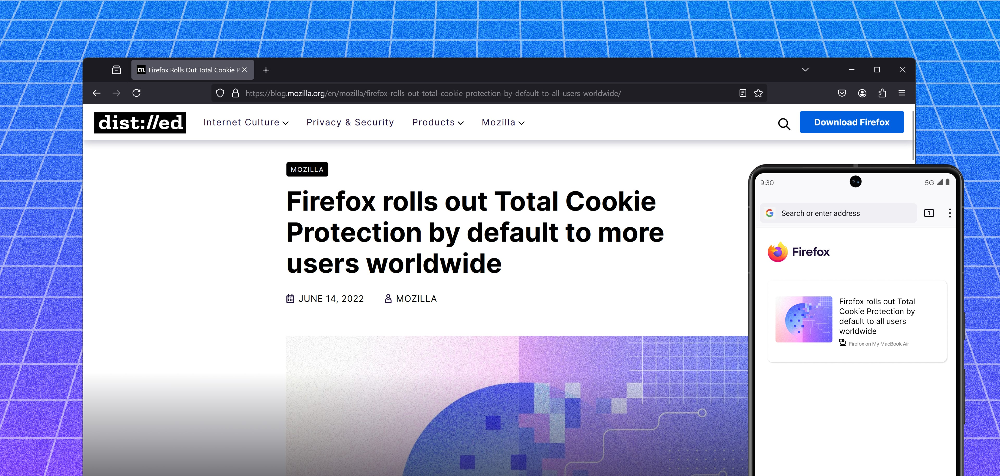

Скачать приложение:
  - [Официальный сайт](https://www.mozilla.org/ru/firefox/new/)
  - [Microsoft Store](https://apps.microsoft.com/detail/9NZVDKPMR9RD?hl=ru&gl=RU&ocid=pdpshare)
  - [Apple Store](https://apps.apple.com/us/app/firefox-private-web-browser/id989804926)

Настройка:
  - ["Full-FireFox-browser-setup"](https://github.com/Un1korm/Full-FireFox-browser-setup) (Un1korm)
  - ["Настраиваем Firefox для полной анонимности..."](https://www.youtube.com/watch?v=XLOvZCdzwp8) (CyberYozh)
  - ["Кастомизация Firefox - сторонние темы..."](https://www.youtube.com/watch?v=pcQzxkQwFk0&t) (Markella's)
  - ["Прокачка браузера FireFox..."](https://www.youtube.com/watch?v=PGF8H-iCudk&t) (ГЛАВНАЯ МРАЗЬ ЮТУБА)

Это бесплатный веб-браузер с открытым исходным кодом, разработанный компанией Mozilla. Он предлагает пользователям высокую скорость загрузки страниц, поддержку множества расширений и функций для повышения безопасности и конфиденциальности. Firefox включает встроенные инструменты для блокировки трекеров и защиты от вредоносных сайтов. Браузер доступен на различных платформах, включая Windows, macOS, Linux, Android и iOS.

## Telegram (Мессенджер):
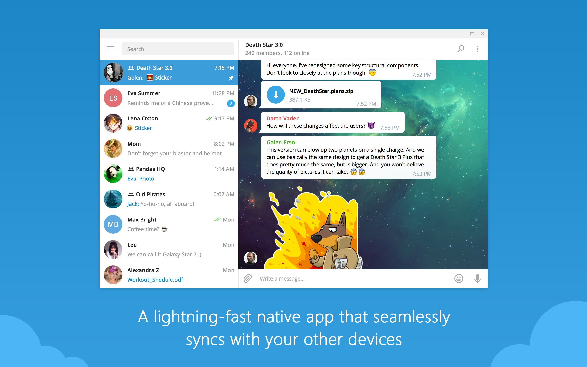

Скачать приложение:
  - [Официальный сайт](https://desktop.telegram.org/)
  - [Microsoft Store](https://apps.microsoft.com/detail/9NZTWSQNTD0S?hl=neutral&gl=RU&ocid=pdpshare)
  - [Apple Store](https://apps.apple.com/us/app/telegram-messenger/id686449807)

Настройка:
  - ["Обход блокировок в России"](https://github.com/Flowseal/tg-ws-proxy) (Flowseal)
  - ["Анонимность в Телеграм..."](https://www.youtube.com/watch?v=cFWK7EozcIQ) (Фантомас)

Популярный мессенджер позволяет пользователям обмениваться текстовыми сообщениями, фотографиями, видео и файлами. Он предлагает функции групповых чатов, каналов и ботов, что делает его удобным для общения и получения информации. Telegram акцентирует внимание на безопасности, предлагая шифрование сообщений и возможность создания секретных чатов. Приложение доступно на различных платформах, включая Windows, macOS, Linux, Android и iOS.

## Discord (Мессенджер):
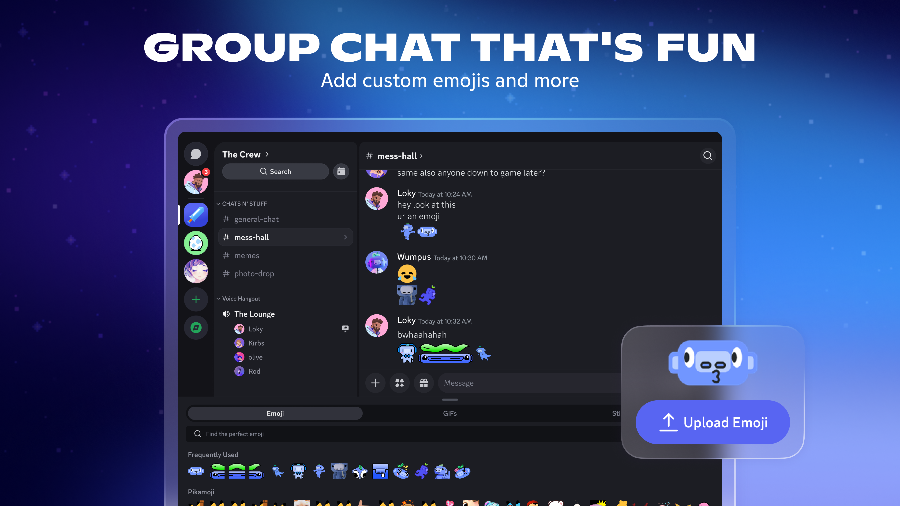

Скачать приложение:
  - [Официальный сайт](https://discord.com/)
  - [Microsoft Store](https://apps.microsoft.com/detail/XPDC2RH70K22MN?hl=ru&gl=RU&ocid=pdpshare)
  - [Apple Store](https://apps.apple.com/us/app/discord-talk-play-hang-out/id985746746)

Настройка:
  - ["Лучшие и полезные ПЛАГИНЫ для ДИСКОРД..."](https://www.youtube.com/watch?v=Sm_JkNS2cJw) (Фрости)
  - ["Лучшие и полезные ПЛАГИНЫ ДИСКОРД..."](https://www.youtube.com/watch?v=KO5c199fbpM) (OfficialBRO)

Многофункциональная платформа для общения, ориентированная на геймеров и сообщества, позволяет пользователям создавать текстовые и голосовые каналы. Discord предлагает функции видеозвонков, обмена файлами и интеграцию с играми, что делает его удобным для совместной игры и общения. Пользователи могут настраивать свои серверы, добавлять ботов и управлять правами доступа. Приложение доступно на различных платформах, включая Windows, macOS, Linux, Android и iOS.

## 7-Zip (Архиватор):
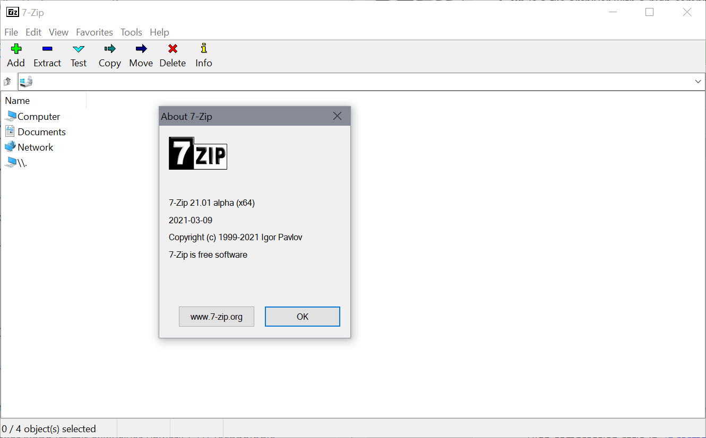

Скачать приложение:
  - [Официальный сайт](https://www.7-zip.org/)

Мощный архиватор с открытым исходным кодом и высокой степенью сжатия в формате 7z (алгоритм LZMA2). 7-Zip поддерживает множество форматов (ZIP, RAR, TAR, GZIP, WIM и другие) и обладает собственным менеджером файлов с двухпанельным интерфейсом. Доступен для Windows, а также существует версия p7zip для Linux.

## Jopdf (PDF редактор):
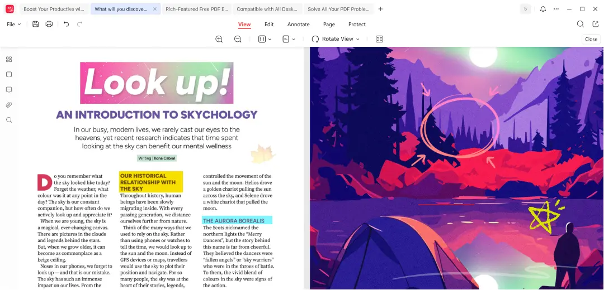

Скачать приложение:
  - [Официальный сайт](https://jopdf.com/)

Программа для создания, конвертации и редактирования PDF-файлов. Поддерживает объединение, разделение, сжатие и защиту документов паролем. Jopdf также позволяет конвертировать изображения и офисные документы в формат PDF. Доступна для Windows.

## LocalSend (Обмен файлами по сети):
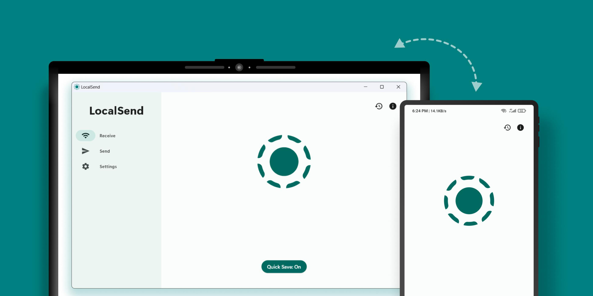

Скачать приложение:
  - [Официальный сайт](https://localsend.org/)
  - [Apple Store](https://apps.apple.com/app/localsend/id1661733229)

Бесплатное приложение с открытым исходным кодом для мгновенной передачи файлов между устройствами в локальной сети. LocalSend не требует интернета, регистрации или облачных сервисов — всё работает по технологии peer-to-peer. Поддерживает отправку фото, видео, документов и целых папок. Доступен на Windows, macOS, Linux, Android и iOS.

## AlterSend (Обмен файлами):
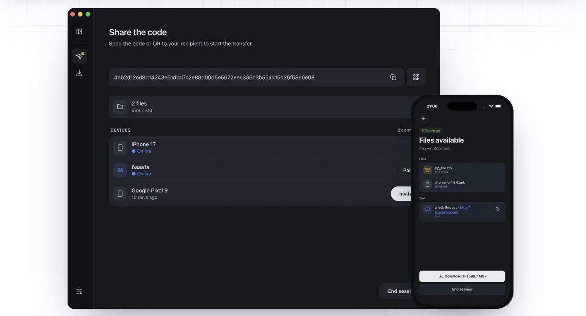

Скачать приложение:
  - [Официальный сайт](https://altersend.com/)

Бесплатный open-source сервис для прямого обмена файлами между устройствами через интернет или локальную сеть. В отличие от LocalSend, работает не только в одной Wi-Fi-сети: устройства соединяются напрямую (P2P), а при невозможности прямого соединения используется зашифрованный релейный сервер, который не видит содержимое файлов. Шифрование end-to-end, без аккаунта и облачного хранения, без ограничений по размеру (от 1 КБ до 200 ГБ), с поддержкой папок и возобновляемой передачей. Получателю не нужно устанавливать приложение — достаточно открыть ссылку в браузере. Доступен на Windows, macOS, Linux, iOS, Android и в вебе.

## Obsidian (Программа для заметок):
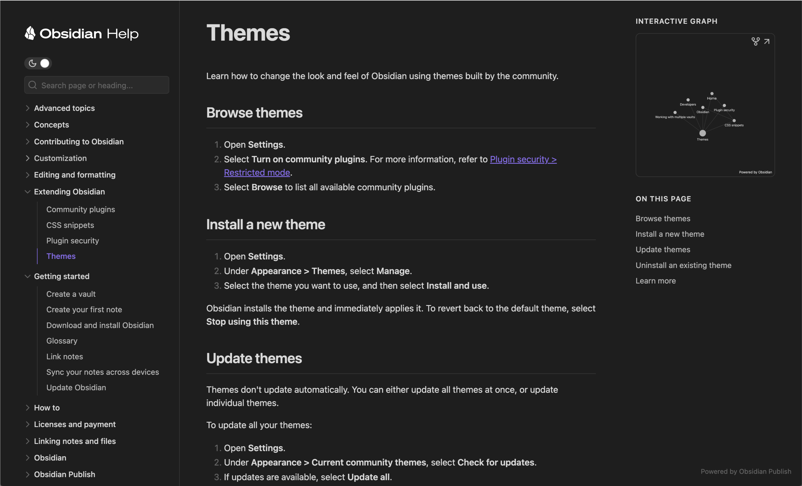

Скачать приложение:
  - [Официальный сайт](https://obsidian.md/download)
  - [Apple Store](https://apps.apple.com/us/app/obsidian-connected-notes/id1557175442)

Настройка:
  - ["Как запоминать ВСЕ с помощью Obsidian..."](https://www.youtube.com/watch?v=Tae0BwhenRQ&t) (ZProger [IT])
  - ["Вам всем нужны эти плагины Obsidian!"](https://www.youtube.com/watch?v=QUK0euS_o1Y) (ZProger [IT])

Программа для создания и управления заметками, основанная на принципах связного мышления и организации информации. Obsidian позволяет пользователям создавать заметки в формате Markdown и связывать их между собой, что облегчает навигацию и поиск информации. Она поддерживает плагины и темы, что позволяет настраивать интерфейс под свои нужды. Приложение доступно на различных платформах, включая Windows, macOS и Linux.

## Bitwarden (Менеджер паролей):
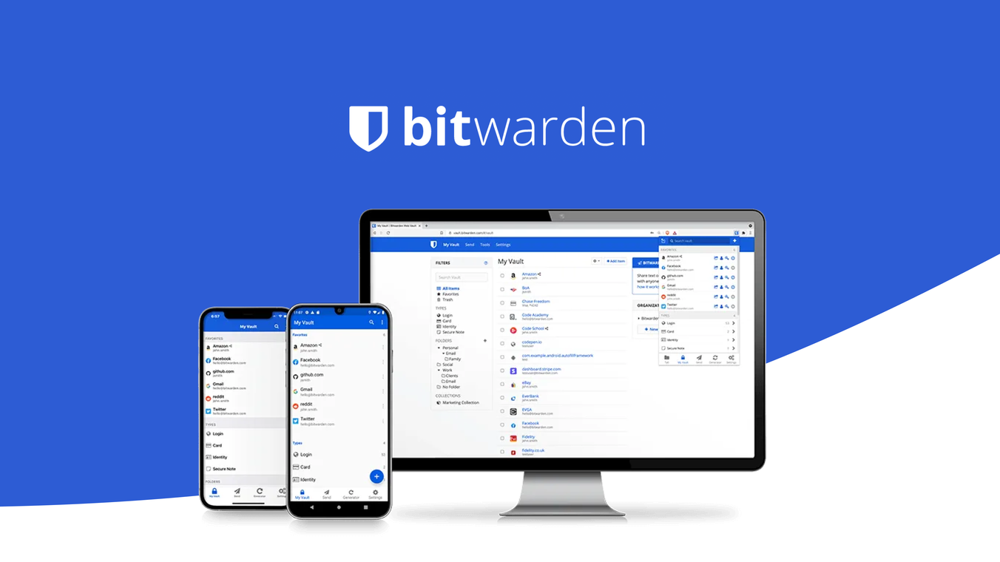

Скачать приложение:
  - [Официальный сайт](https://bitwarden.com/download/)
  - [Официальный сайт Mozilla](https://addons.mozilla.org/en-US/firefox/addon/bitwarden-password-manager/?browser=firefox) (Расширение в FireFox)
  - [Официальный сайт Google](https://chromewebstore.google.com/detail/bitwarden-%D0%BC%D0%B5%D0%BD%D0%B5%D0%B4%D0%B6%D0%B5%D1%80-%D0%BF%D0%B0%D1%80%D0%BE%D0%BB%D0%B5/nngceckbapebfimnlniiiahkandclblb?hl=ru&utm_source=ext_sidebar) (Расширение в Google)
  - [Microsoft Store](https://apps.microsoft.com/detail/9PJSDV0VPK04?hl=ru&gl=RU&ocid=pdpshare)
  - [Apple Store](https://apps.apple.com/us/app/bitwarden-password-manager/id1137397744)

Менеджер паролей Bitwarden предлагает пользователям безопасное хранение и управление паролями, а также генерацию надежных паролей для различных учетных записей. Он обеспечивает шифрование данных на стороне клиента, что гарантирует защиту личной информации. Bitwarden поддерживает синхронизацию между устройствами и предоставляет возможность совместного использования паролей с другими пользователями. Приложение доступно на различных платформах, включая Windows, macOS, Linux, Android и iOS.

## iCloud (Облачное хранилище):
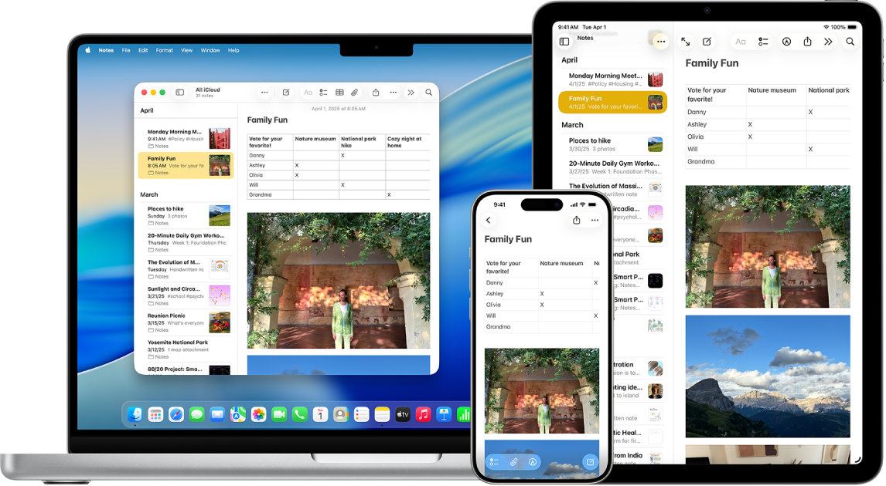

Скачать приложение:
  - [Microsoft Store](https://apps.microsoft.com/detail/9pktq5699m62?hl=ru-RU&gl=RU)

Облачный сервис от Apple для хранения фотографий, видео, документов, заметок, контактов и резервных копий устройств. Приложение iCloud для Windows позволяет синхронизировать данные между iPhone/iPad/Mac и компьютером с Windows, включая общий доступ к фото, паролям, закладкам и файлам через проводник. Доступен на Windows, macOS, iOS, Android (веб-версия).

## Windscribe (VPN-сервис):
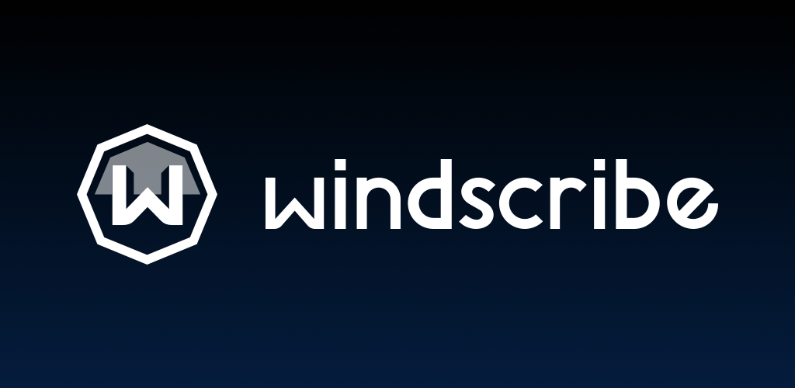

Скачать приложение:
  - [Официальный сайт](https://windscribe.com/download/)
  - [Apple Store](https://apps.apple.com/us/app/windscribe-vpn/id1129435228)

Настройка:
  - ["КАК ПОЛЬЗОВАТЬСЯ WINDSCRIBE..."](https://www.youtube.com/watch?v=lkp6Tx0AcwY) (VPN Эксперт)

Это VPN-сервис, который обеспечивает безопасное и анонимное интернет-соединение, позволяя пользователям обходить географические ограничения и защищать свои данные от слежки. Он предлагает функции шифрования, блокировки рекламы и защиты от утечек DNS. Windscribe также предоставляет возможность выбора серверов в различных странах для оптимизации скорости и доступа к контенту. Приложение доступно на различных платформах, включая Windows, macOS, Linux, Android и iOS.

## Zapret Discord Youtube (Обход блокировок DS/YT):
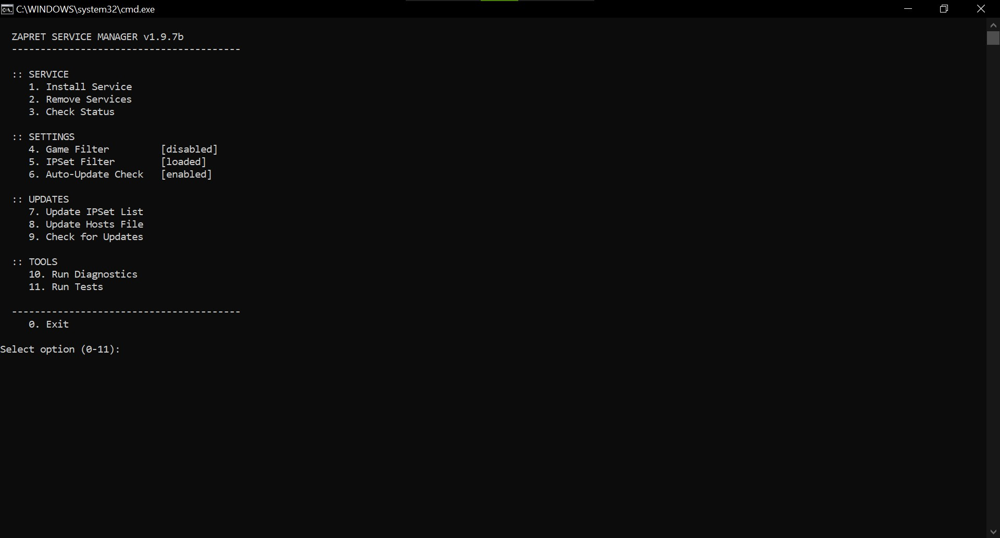

Скачать приложение:
  - [GitHub](https://github.com/Flowseal/zapret-discord-youtube)

Набор скриптов и утилит для обхода государственных блокировок (Deep Packet Inspection) таких платформ, как Discord и YouTube, на Windows. Проект основан на `zapret` от bol-van и предоставляет готовые стратегии обхода (ALT, FAKE, SIMPLE и другие). Программа может быть установлена как служба для автозапуска или запускаться вручную. **Важно:** Антивирусы могут ложно срабатывать на WinDivert — добавьте папку с программой в исключения. Доступно только для Windows.

## TG WS Proxy (Обход блокировки TG):
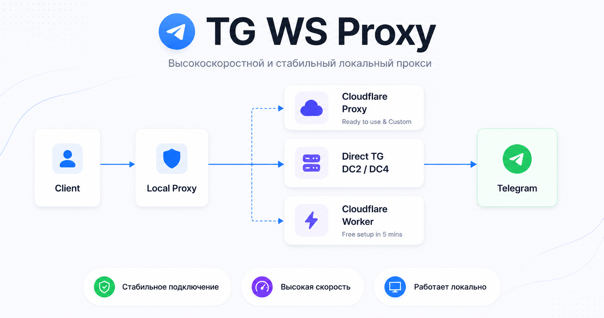

Скачать приложение:
  - [GitHub](https://github.com/Flowseal/tg-ws-proxy)

Локальный MTProto-прокси сервер для ускорения работы Telegram Desktop, который перенаправляет трафик через WebSocket-соединения. Приложение поднимает прокси на `127.0.0.1:1443`, перехватывает подключения к IP-адресам Telegram и устанавливает WebSocket-соединение (TLS) к соответствующим DC через домены Telegram. Данные передаются в зашифрованном виде, для работы не нужны сторонние серверы. Работает в системном трее — достаточно один раз настроить Telegram и забыть. Доступно для Windows 7/10/11, macOS и Linux.

## WinToys (Оптимизация):
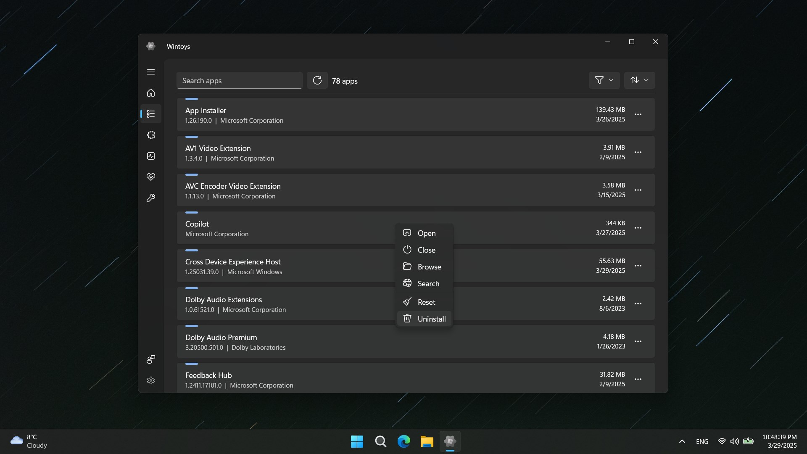

Скачать приложение:
  - [Официальный сайт](https://bogdan-patraucean.github.io/about/wintoys/)
  - [Microsoft Store](https://apps.microsoft.com/detail/9p8ltpgcbzxd?hl=ru-RU&gl=RU)

Настройка:
  - ["Оптимизируй Windows и сделай её быстрее..."](https://www.youtube.com/watch?v=x4er0gbQYHA) (Werstey)

Бесплатная утилита с открытым исходным кодом для тонкой настройки Windows 11 и 10. WinToys объединяет множество скрытых настроек системы в удобном интерфейсе: отключение телеметрии, настройка контекстного меню, управление автозагрузкой, кастомизация интерфейса и оптимизация производительности. Доступна в Microsoft Store.

## Win10Tweaker (Оптимизация):
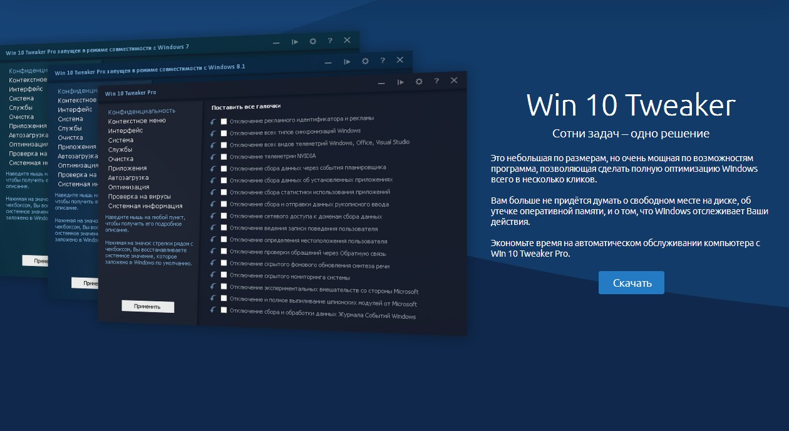

Скачать приложение:
  - [Официальный сайт](https://win10tweaker.ru/)

Настройка:
  - ["Оптимизация Windows. Пошаговый гайд"](https://youtu.be/UemdsjxTdfg) (MartyFiles)

Портативная утилита для тонкой настройки Windows 10 и 11, позволяющая отключить телеметрию, рекламу, ненужные службы, настроить контекстное меню, проводник и другие скрытые параметры системы. Win10Tweaker не требует установки и включает функцию создания точки восстановления перед изменениями. Доступен для Windows.

## WinClick (Оптимизация):
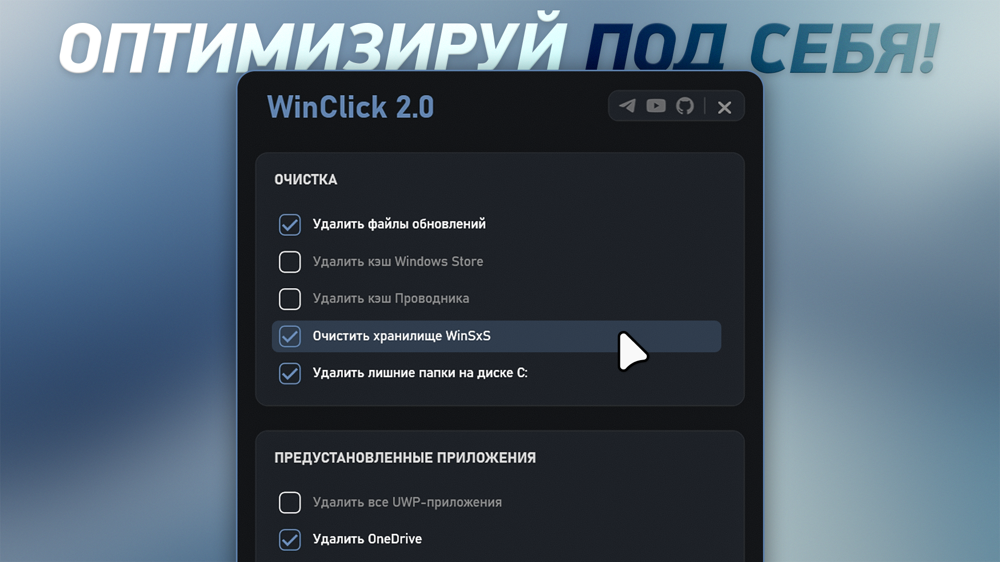

Скачать приложение:
  - [GitHub](https://github.com/MartyFiles/WinClick)

Настройка:
  - ["Optimize Windows 11 in 15 minutes! WinClick 2.0"](https://youtu.be/JMTuY_Gi70U) (MartyFiles)

Бесплатная open-source утилита для быстрой настройки и оптимизации свежеустановленной Windows 11. WinClick объединяет десятки твиков в одном интерфейсе: очистка системы, удаление предустановленных UWP-приложений, удаление Microsoft Edge и Защитника Windows, отключение телеметрии, оптимизация параметров производительности, настройка Центра обновлений, визуальные твики и даже сжатие системы. Рекомендуется запускать на чистой установке Windows 11 Pro (25H2+) **без подключения к интернету** для беспроблемного удаления Edge, WebView2 и Защитника. Доступно только для Windows 11.

## PowerToys (Набор утилит):
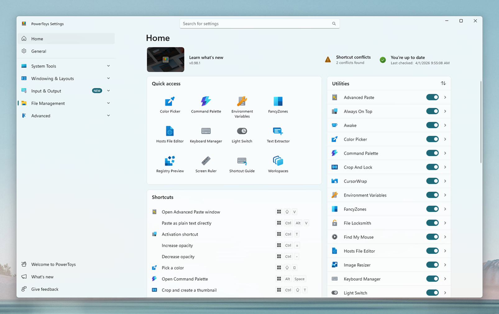

Скачать приложение:
  - [Microsoft Store](https://apps.microsoft.com/detail/xp89dcgq3k6vld)
  - [GitHub](https://github.com/microsoft/PowerToys)

Бесплатный набор утилит с открытым исходным кодом от Microsoft для продвинутых пользователей Windows 10 и 11. Включает десятки инструментов, расширяющих стандартные возможности системы: FancyZones (менеджер раскладки окон), PowerRename (массовое переименование), Keyboard Manager (переназначение клавиш), PowerToys Run (быстрый запуск приложений), Color Picker, Image Resizer, Always on Top и другие. Все утилиты доступны из единого интерфейса настроек, поддерживают горячие клавиши и регулярно обновляются. Доступен в Microsoft Store и на GitHub.

## FluentCleaner (Очистка системы):
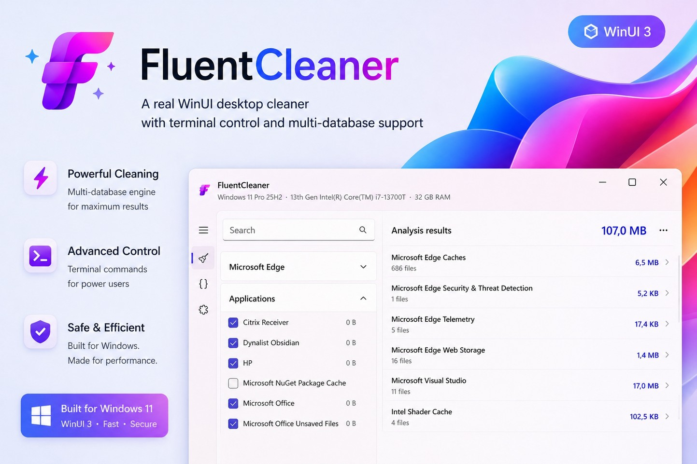

Скачать приложение:
  - [GitHub](https://github.com/builtbybel/FluentCleaner)

Бесплатная утилита с открытым исходным кодом для глубокой очистки системы, созданная как современная альтернатива CCleaner. Имеет нативный и понятный интерфейс для Windows 11 (WinUI 3), не содержит рекламы и телеметрии. Благодаря использованию огромной базы правил `winapp2.ini` от сообщества, FluentCleaner находит и безопасно удаляет значительно больше файлового мусора (кэш браузеров, временные файлы приложений, логи), чем встроенные средства Windows. Не требует установки (портативная версия) и не удаляет сами программы, работая строго с временными файлами.

## Revo Uninstaller (Деинсталлятор программ):
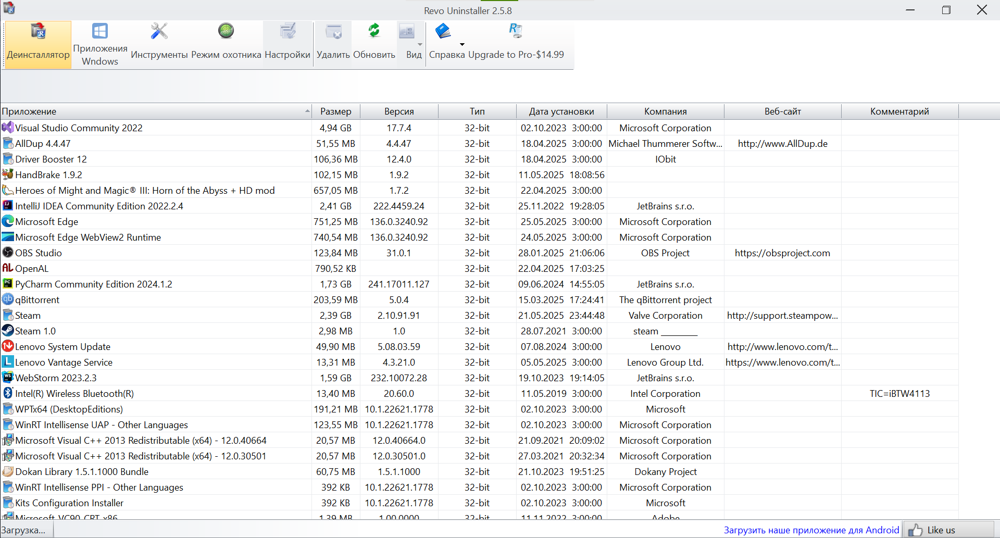

Скачать приложение:
  - [Официальный сайт](https://www.revouninstaller.com/ru/revo-uninstaller-free-download/)

Программа для удаления приложений и очистки системы от остатков файлов и записей в реестре. Revo Uninstaller предлагает несколько режимов удаления, включая стандартный и продвинутый, что позволяет пользователям эффективно управлять установленными программами. Она также включает инструменты для управления автозагрузкой и поиска программ. Приложение доступно на платформах Windows.

## Steam (Магазин игр):
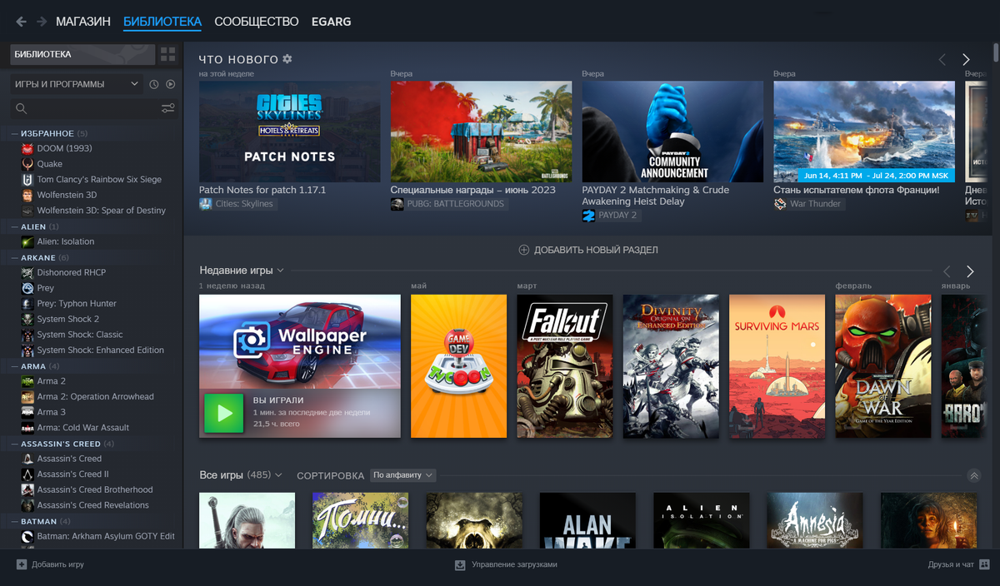

Скачать приложение:
  - [Официальный сайт](https://store.steampowered.com/about/)
  - [Apple Store](https://apps.apple.com/us/app/steam-mobile/id495369748)

Настройка:
  - ["ПРОВЕРИЛ 32 СЕРВИСА ПОПОЛНЕНИЯ СТИМ..."](https://www.youtube.com/watch?v=q4NBiRZatQo&t) (STEAMATE)
  - ["Смена региона STEAM 2025..."](https://www.youtube.com/watch?v=uKawuDbiBDQ) (Buzzard)
  - ["Как Пополнить Стим 2025..."](https://www.youtube.com/watch?v=ZRuYllFCDoA) (DorrianKarnett™)

Платформа для цифровой дистрибуции игр и программного обеспечения, позволяющая пользователям покупать, загружать и играть в игры. Steam предлагает функции социальной сети, включая возможность добавления друзей, чатов и групповых игр. Пользователи также могут участвовать в распродажах и получать доступ к эксклюзивным предложениям. Приложение доступно на различных платформах, включая Windows, macOS и Linux.

## Epic Games (Магазин игр):

Скачать приложение:
  - [Официальный сайт](https://store.epicgames.com/ru/download)
  - [Microsoft Store](https://apps.microsoft.com/detail/XP99VR1BPSBQJ2?hl=ru&gl=RU&ocid=pdpshare)

Настройка:
  - ["СМЕНА РЕГИОНА в EPIC GAMES STORE..."](https://www.youtube.com/watch?v=1poDn4xBIYI) (heybk)
  - ["Как оплатить игру в EPIC GAMES рублями?..."](https://www.youtube.com/watch?v=hMx6S3lUcZE) (Pay Unlimited)

Платформа для цифровой дистрибуции игр, предлагающая пользователям доступ к большому количеству игр, включая эксклюзивные проекты. Epic Games Store регулярно проводит распродажи и предлагает бесплатные игры, что привлекает множество пользователей. Платформа также поддерживает функции социальной сети, такие как добавление друзей и создание групп. Приложение доступно на различных платформах, включая Windows, macOS и мобильные устройства.

## qBittorrent (Торрент-клиент):
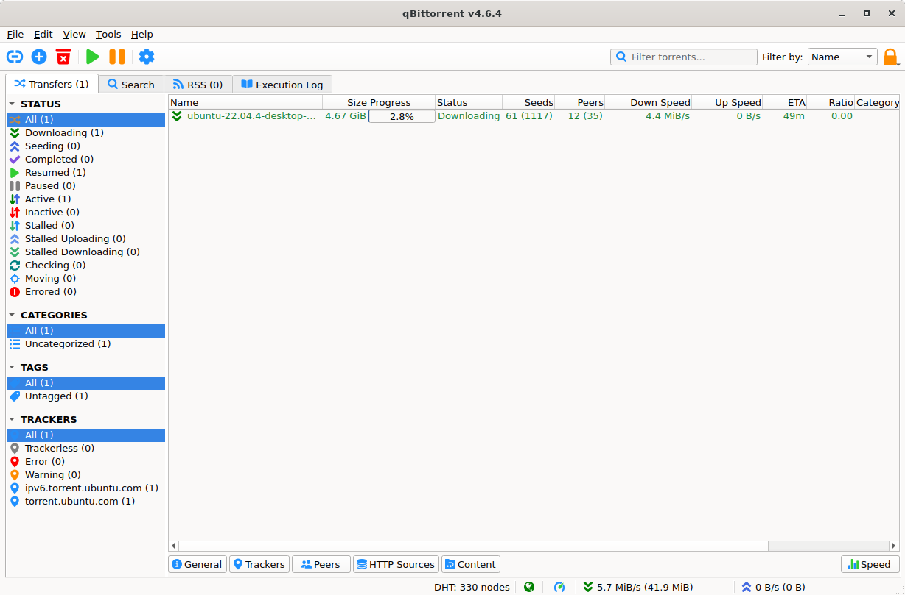

Скачать приложение:
  - [Официальный сайт](https://www.qbittorrent.org/)

Бесплатный торрент-клиент с открытым исходным кодом, не содержащий рекламы и скрытых трекеров. qBittorrent поддерживает последовательную загрузку, шифрование, ограничение скорости, встроенный поиск по торрент-трекерам, RSS-ленты и удалённое управление через веб-интерфейс. Работает на Windows, macOS, Linux и FreeBSD.

## PyCharm (Редактор кода Python):
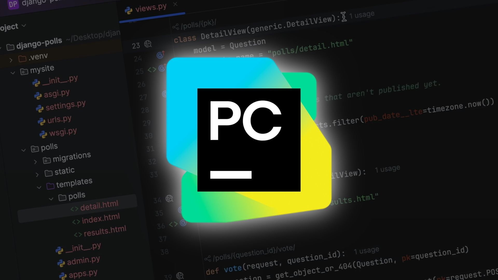

Скачать приложение:
  - [Официальный сайт](https://www.jetbrains.com/pycharm/download/)

Интегрированная среда разработки (IDE) для языка Python от компании JetBrains. PyCharm предоставляет мощные инструменты для написания кода: умное дополнение кода, анализ ошибок в реальном времени, мощный отладчик и встроенную поддержку систем контроля версий (Git, Mercurial и др.). Доступна в двух версиях: бесплатной Community (с открытым исходным кодом) и платной Professional с расширенными возможностями для веб-разработки. Приложение доступно на платформах Windows, macOS и Linux.

## Visual Studio Code (Редактор кода):
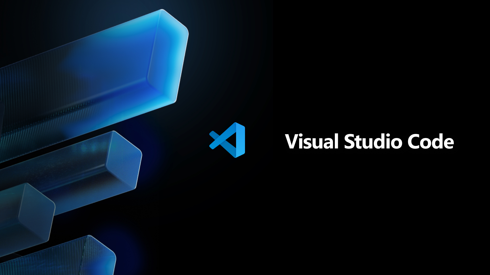

Скачать приложение:
  - [Официальный сайт](https://code.visualstudio.com/)
  - [Microsoft Store](https://apps.microsoft.com/detail/xp9khm4bk9fz7q?hl=ru-RU&gl=RU)

Мощный, легкий и бесплатный редактор исходного кода от Microsoft. Благодаря огромной экосистеме расширений, VS Code поддерживает практически все языки программирования (Python, C++, Java, JavaScript, Go и др.), фреймворки и инструменты. Имеет встроенную поддержку Git, терминал и умный автодополнитель IntelliSense. Приложение доступно на платформах Windows, macOS и Linux.

## WinDynamicDesktop (Динамические обои):
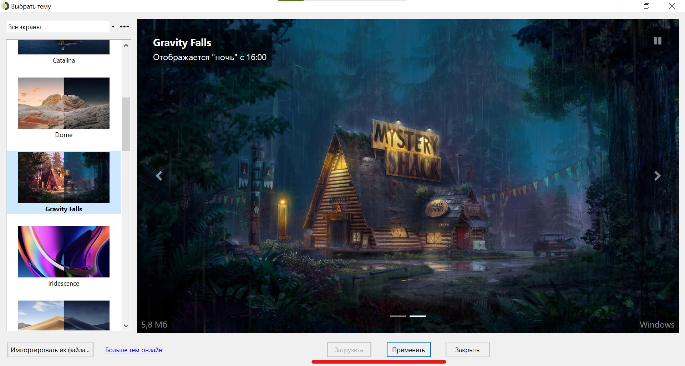

Скачать приложение:
  - [Официальный сайт](https://windd.info/)
  - [Microsoft Store](https://apps.microsoft.com/detail/9nm8n7dq3z5f?hl=ru-RU&gl=RU)
  - [GitHub](https://github.com/t1m0thyj/WinDynamicDesktop)

Настройка:
  - ["Как настроить динамические обои на Windows"](https://github.com/Un1korm/Custom-day-night-double-wallpaper-WinDynamicDesktop) (Un1korm)

Программа, которая добавляет на Windows динамические обои, меняющиеся в зависимости от времени суток или географического положения (аналог функции macOS). WinDynamicDesktop поддерживает загрузку готовых наборов обоев, создание собственных расписаний и автоматическое обновление фона рабочего стола. Доступна для Windows 10 и 11.

## VLC Media Player (Медиапроигрыватель):
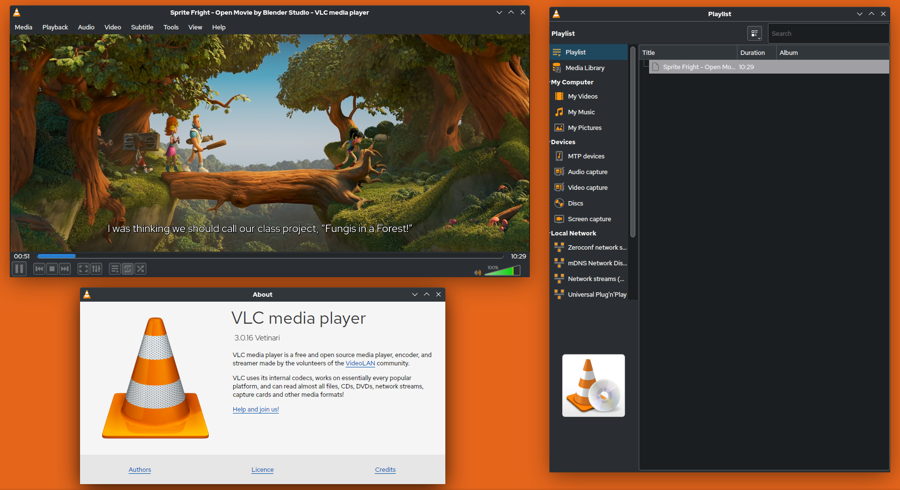

Скачать приложение:
  - [Официальный сайт](https://www.videolan.org/vlc/)
  - [Microsoft Store](https://apps.microsoft.com/detail/xpdm1zw6815mqm?hl=ru-RU&gl=AR)
  - [Apple Store](https://apps.apple.com/app/vlc-media-player/id650377962)

Универсальный бесплатный медиапроигрыватель с открытым исходным кодом, поддерживающий практически все форматы аудио и видео без необходимости установки дополнительных кодеков. VLC умеет воспроизводить повреждённые или недогруженные файлы, стримить контент по сети, применять фильтры и менять скины. Доступен на Windows, macOS, Linux, Android и iOS.

## OBS Studio (Запись экрана):
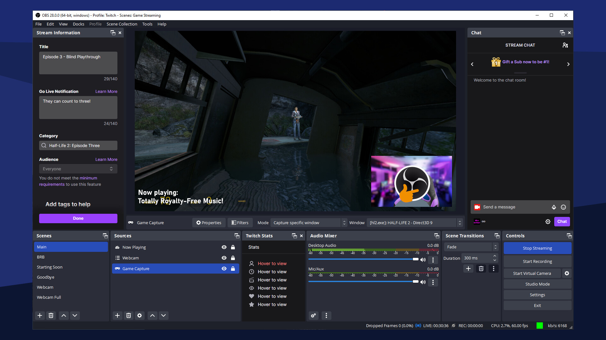

Скачать приложение:
  - [Официальный сайт](https://obsproject.com/ru)
  - [Microsoft Store](https://apps.microsoft.com/detail/xpffh613w8v6lv?hl=ru-RU&gl=RU)

Профессиональное программное обеспечение с открытым исходным кодом для захвата видео, записи экрана и потокового вещания в реальном времени. OBS Studio позволяет создавать сцены с множеством источников (окна, игры, веб-камеры), настраивать переходы, применять фильтры и использовать горячие клавиши. Поддерживает все популярные платформы для стриминга. Доступен на Windows, macOS и Linux.

## OpenScreen (Запись экрана):
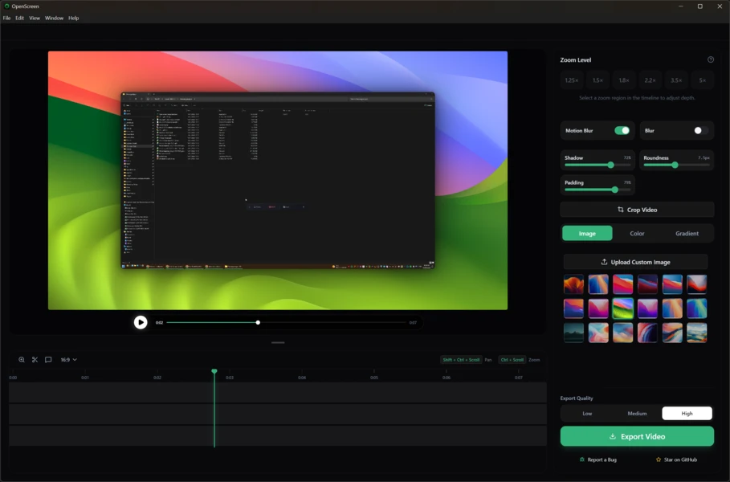

Скачать приложение:
  - [Официальный сайт](https://getopenscreen.com/)

Бесплатная программа с открытым исходным кодом (MIT) для записи экрана и редактирования видео. Работает нативно на Windows (Windows Graphics Capture), macOS и Linux, рендеринг и предпросмотр выполняются на GPU — то, что видно в редакторе, совпадает с итоговым экспортом. Поддерживает запись окна или всего экрана вместе с системным звуком, микрофоном и камерой, монтаж на таймлайне, аннотации, субтитры через локальный Whisper и экспорт в MP4 или GIF. Не требует аккаунта и работает без интернета (кроме первичной загрузки модели субтитров). Доступна на Windows 10 (1903+), macOS и Linux.

## CompressO (Сжатие видео):
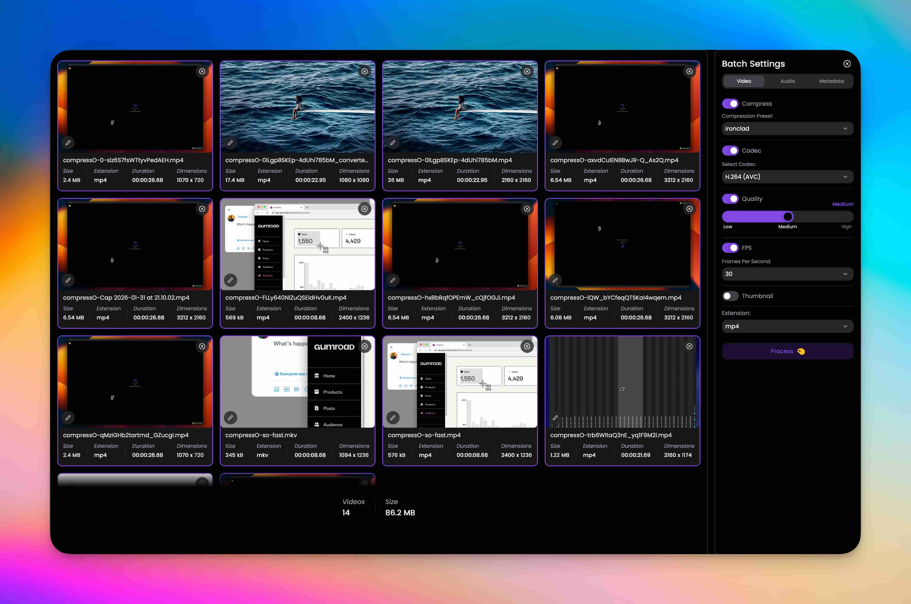

Скачать приложение:
  - [Официальный сайт](https://compresso.codeforreal.com/)

Мощный бесплатный компрессор видео на английском языке, который работает **локально в браузере** — ничего не загружается на сервер, всё сжатие происходит на вашем устройстве. Позволяет сжимать ролики с минимальной потерей качества, например, с 500 МБ до 50 МБ. Поддерживает пакетную загрузку нескольких видео одновременно — можно запустить конвертацию и заниматься своими делами. Идеально подходит, когда нужно быстро отправить тяжёлый файл через Telegram, почту или мессенджеры. Доступен через веб-интерфейс на Windows, macOS и Linux.

## Caesium Image Compressor (Сжатие изображений):
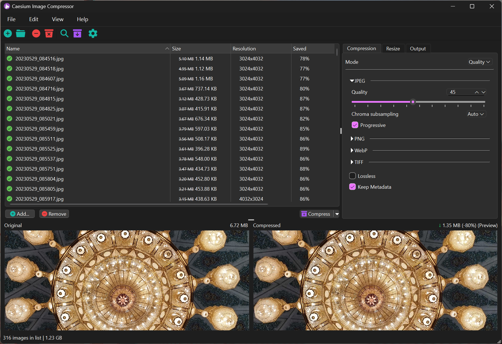

Скачать приложение:
  - [Официальный сайт](https://saerasoft.com/caesium)
  - [GitHub](https://github.com/Lymphatus/caesium-image-compressor)

Бесплатный инструмент с открытым исходным кодом для сжатия PNG, JPG и WebP изображений без заметной потери качества. Caesium поддерживает пакетную обработку, предпросмотр результата и настройку уровня сжатия. Позволяет уменьшить размер изображений до 80%, сохраняя оригинальное разрешение. Доступен на Windows, macOS и Linux.

## Krita AI Diffusion (AI-рисование):
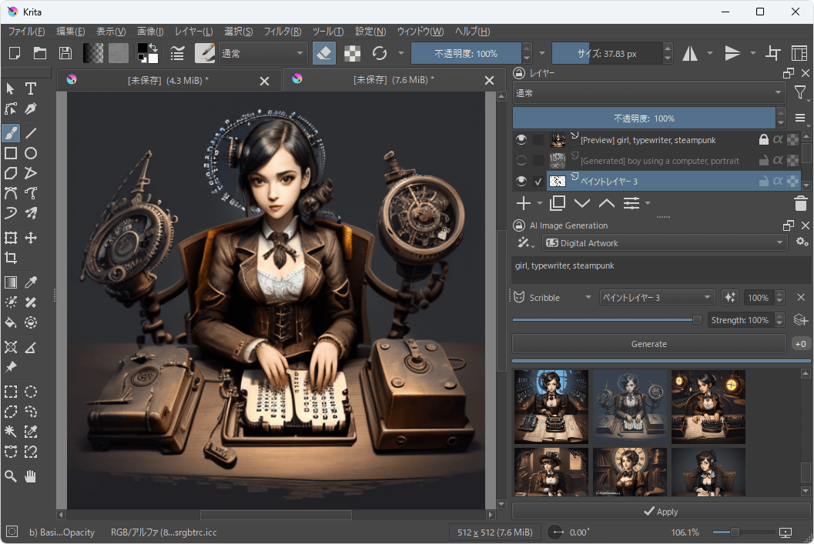

Скачать приложение:
  - [Krita (официальный сайт)](https://krita.org/)
  - [Плагин на GitHub](https://github.com/Acly/krita-ai-diffusion)

Бесплатный плагин с открытым исходным кодом, превращающий Krita в инструмент для генеративного рисования с локальным запуском AI-моделей. Интегрирует Stable Diffusion и другие модели прямо в рабочее пространство Krita: можно рисовать эскиз, выделять область и генерировать или дорабатывать изображение с помощью текстового запроса, сохраняя контроль над структурой через ControlNet. Всё выполняется на локальном GPU (рекомендуется от 6 ГБ видеопамяти), без облака и подписок. Требует установленной Krita 5.2.0+ и подключения локального бэкенда ComfyUI (плагин может настроить его автоматически). Доступен на Windows, macOS и Linux.

## Everything (Поисковик файлов):
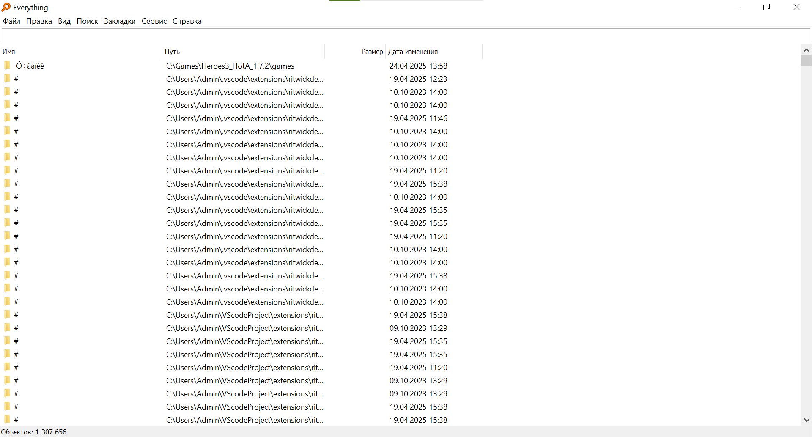

Скачать приложение:
  - [Официальный сайт](https://www.voidtools.com/ru-ru/downloads/)

Программа для быстрого поиска файлов и папок на компьютере, обеспечивающая мгновенные результаты благодаря индексации содержимого дисков. Everything позволяет пользователям легко находить нужные файлы по имени и предоставляет возможность фильтрации и сортировки результатов. Интерфейс программы прост и интуитивно понятен, что делает её удобной в использовании. Приложение доступно на платформах Windows и macOS.

## PC Manager (Оптимизатор):
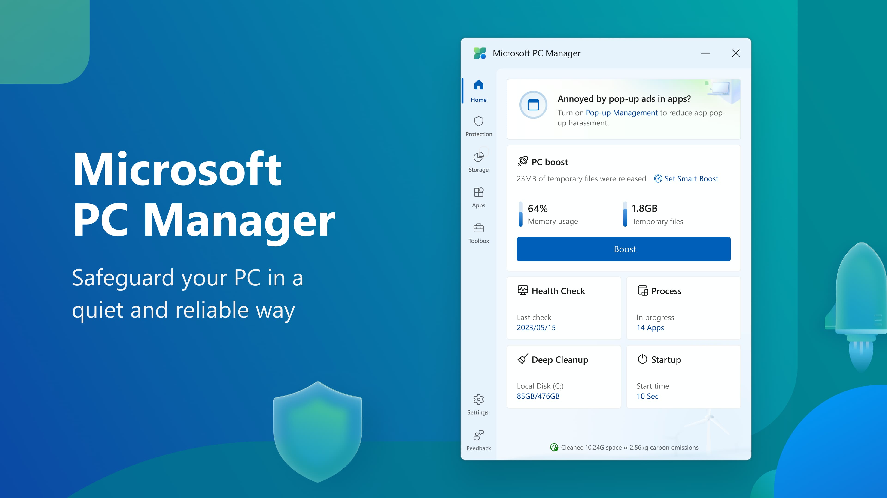

Скачать приложение:
  - [Официальный сайт](https://pcmanager.microsoft.com/)

Бесплатная утилита от Microsoft для базового обслуживания и оптимизации Windows. Объединяет очистку временных файлов и кэша, управление автозагрузкой, мониторинг здоровья системы и базовую защиту в одном простом интерфейсе. Ориентирована на пользователей, которым нужен лёгкий инструмент «всё в одном» без глубокого погружения в настройки. Доступна для Windows 10 и 11.

## Проверка работоспособности ПК (Диагностика):
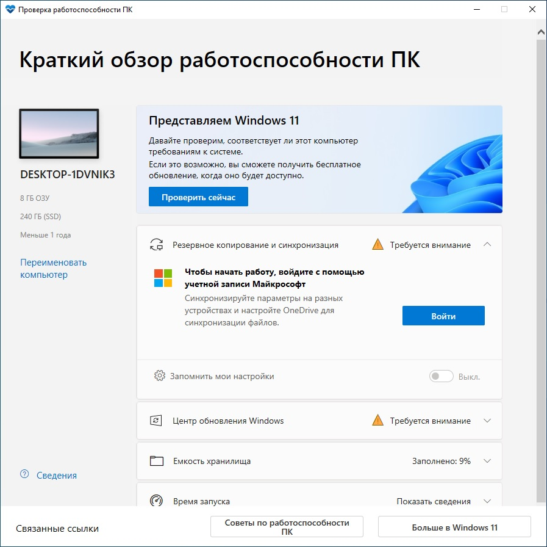

Встроенная утилита Windows, не требующая установки. Доступна через Панель управления → «Безопасность и обслуживание» → «Проверка работоспособности ПК» (или через поиск в меню Пуск). Отслеживает состояние системы, автоматически выявляет проблемы с дисками, памятью, драйверами, обновлениями и безопасностью, а также предлагает решения по устранению неполадок. Показывает историю сбоев и текущий статус ключевых компонентов системы. Доступна на Windows 7, 8, 10 и 11.

## MinerSearch (Поиск и удаление майнеров):
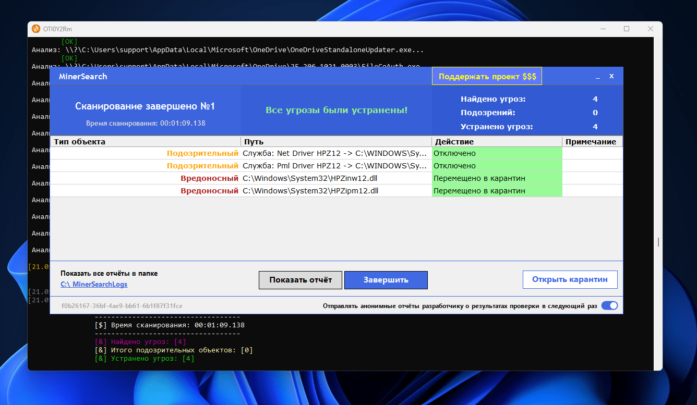

Скачать приложение:
  - [GitHub](https://github.com/BlendLog/MinerSearch)

Специализированная утилита для поиска и полного удаления скрытых криптомайнеров в системе Windows. MinerSearch не заменяет антивирус, а является узконаправленным инструментом для борьбы с вредоносным ПО, которое незаметно использует ресурсы процессора или видеокарты для добычи криптовалюты. Программа завершает вредоносные процессы, удаляет файлы, очищает автозапуск и планировщик задач, а также обнаруживает rootkit R77. Обнаруженные угрозы помещаются в карантин с возможностью восстановления. Требует прав администратора и наличия .NET Framework 4.7.2. Доступна только для Windows.

## WhoCrashed (Анализ крашей):
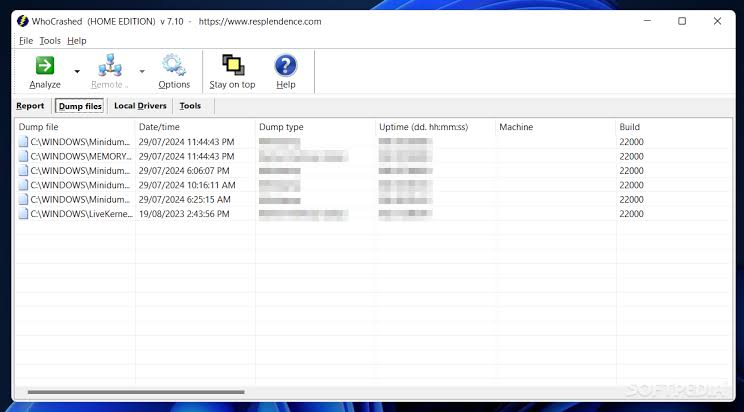

Скачать приложение:
  - [Официальный сайт](https://www.resplendence.com/whocrashed)

Бесплатная утилита для анализа дампов памяти Windows после синего экрана смерти (BSOD) или внезапной перезагрузки. WhoCrashed в один клик анализирует crash-дампы и определяет наиболее вероятную причину сбоя — неисправный драйвер или проблему с оборудованием (повреждение памяти, перегрев). Формирует отчёт с рекомендациями и ссылками для дальнейшей диагностики. Поддерживает анализ как локальной системы, так и удалённого компьютера в сети. Доступна только для Windows.

## Driver Booster (Обновление драйверов):
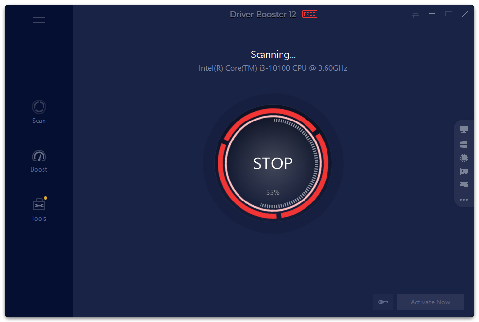

Скачать приложение:
  - [Официальный сайт](https://ru.iobit.com/driver-booster.php)
  - [Microsoft Store](https://apps.microsoft.com/detail/XPFM0B62TJ71KR?hl=ru&gl=RU&ocid=pdpshare)

Программа для автоматического обновления драйверов на компьютере, обеспечивающая стабильную работу оборудования и улучшение производительности системы. IObit Driver Booster сканирует систему на наличие устаревших драйверов и предлагает их обновление одним кликом. Она также включает функции резервного копирования и восстановления драйверов. Приложение доступно на платформах Windows.

## WizTree (Анализ дискового пространства):
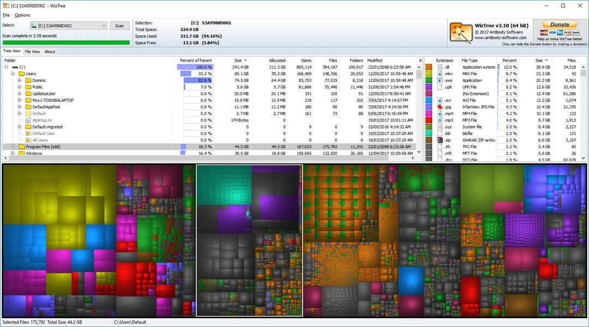

Скачать приложение:
  - [Официальный сайт](https://wiztreefree.com/)

Мгновенный анализатор дискового пространства, который считывает данные напрямую из MFT (Master File Table), что делает его самым быстрым среди аналогов. WizTree отображает занятое место в виде интерактивной древовидной карты (treemap), позволяя визуально определить самые большие папки и файлы. Поддерживает NTFS, FAT, exFAT и сетевые диски. Доступен только для Windows.

## iMazing (Резервная копия iOS):
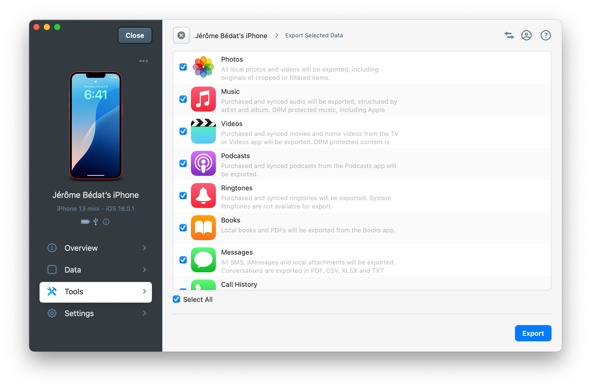

Скачать приложение:
  - [Официальный сайт](https://imazing.com/ru/download)

Мощный менеджер для устройств Apple (iPhone, iPad, iPod), который предоставляет гораздо больше возможностей, чем стандартный iTunes. iMazing позволяет создавать резервные копии, управлять музыкой, фото и приложениями, а также сохранять на компьютер приложения, которые были удалены из App Store. Это незаменимый инструмент для тех, кто хочет иметь полный контроль над данными своего iOS-устройства. Приложение доступно на платформах Windows и macOS.

## AOMEI Backupper (Резервная копия ПК):
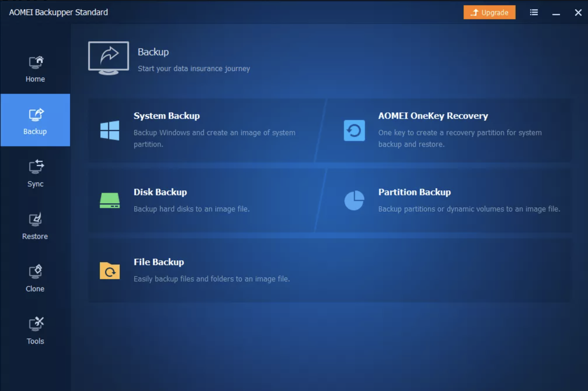

Скачать приложение:
  - [Официальный сайт](https://www.aomeitech.com/download.html)
  - [Microsoft Store](https://apps.microsoft.com/detail/xp9mftnfw3dk13?hl=ru-RU&gl=RU)

Настройка:
  - [Резервное копирование Windows. Создание и восстановление бэкапа](https://youtu.be/rHg_kV5xJnk?si=QgzAFC4YnOCWl9zT) (MartyFiles)

Надежное и простое в использовании программное решение для резервного копирования и восстановления данных. Позволяет создавать резервные копии системы, отдельных дисков, разделов и файлов. В бесплатной версии Standard доступны основные функции, такие как клонирование дисков, синхронизация файлов и создание загрузочного носителя для восстановления системы. Приложение доступно только на платформе Windows.

## Устройства Apple (Сброс и обновление):
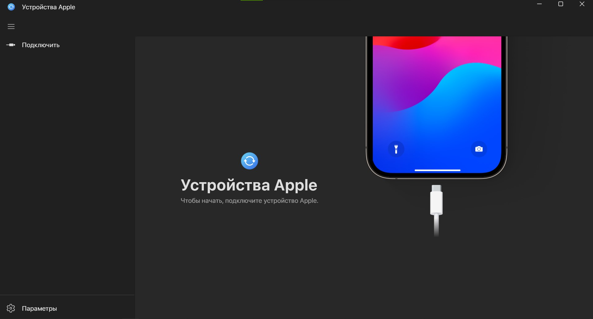

Скачать приложение:
  - [Microsoft Store](https://apps.microsoft.com/detail/9np83lwlpz9k?hl=ru-RU&gl=RU)

Официальное приложение от Apple для синхронизации данных между устройствами (iPhone, iPad, Mac) и компьютером на Windows. Позволяет получить доступ к фотографиям, контактам, календарям, заметкам, закладкам Safari и паролям прямо на ПК. Поддерживает общий доступ к файлам через проводник и автоматическую загрузку фото из облака. Приложение доступно на платформе Windows.
